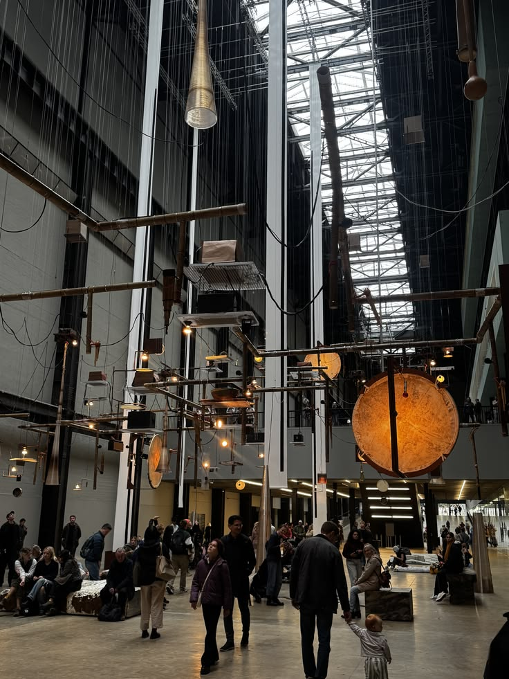
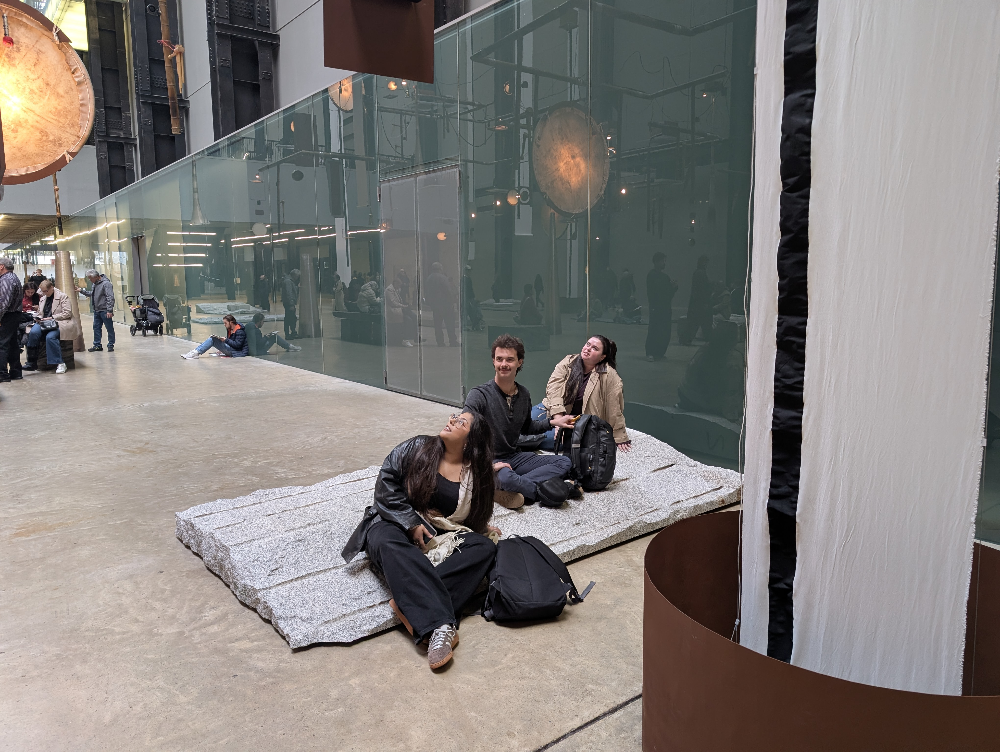
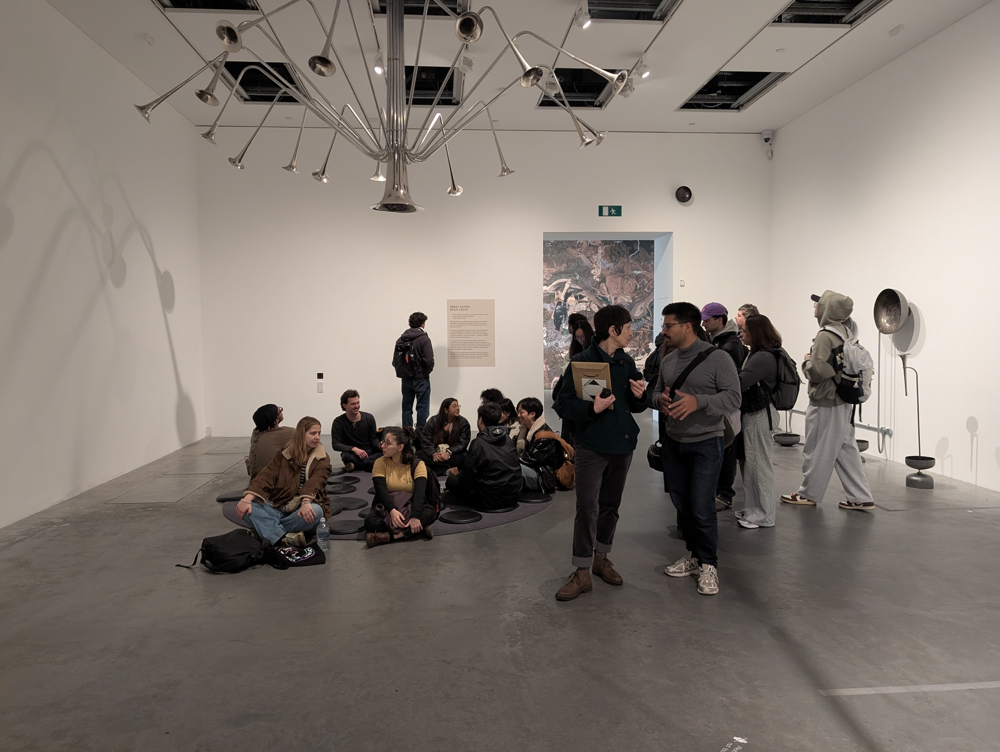

### C4DM Field Trip: Tarek Atoui at Turbine Hall (Tate Modern)

*Organised by Charalampos Saitis and Anna Xambó Sedó. Photos by Charalampos Saitis. Written by Nico García-Peguinho*

An email entitled "Spontaneous Field Trip" did the rounds at the end of last week and I was delighted to see that it was an excuse to return to Tarek Atoui's Turbine Hall exhibition at the Tate Modern. A group of students and academics from the Interactive Digital Multimedia Techniques cohort (from the [Sound and Music Computing Masters](https://www.qmul.ac.uk/postgraduate/taught/coursefinder/courses/sound-and-music-computing-msc/)) and the Centre for Digital Music were rallied for a morning of listening, looking, touching and speculating about what was controlling the vast cybernetic installation.

A written description doesn't do it justice but here goes: a canopy of sound sculptures suspended from the Turbine Hall ceiling; bamboo pipes feeding air into ensembles of closely tuned mouth organs; boomy circular drum skins with mechanised mallets; dancing textile sails of washi and cotton; flared horns made from bamboo dust and sugar resin; speakers hidden between floating materials and within stone slabs on the floor; and microphones listening back.

The space was punctuated with indeterminate combinations of instruments, with ensembles that cohered long enough to become familiar before dissolving into the next configuration. This brought to mind Pauline Oliveros's idea of focal and global attention: the pull between attending to individual sounds and surrendering to the whole. It also struck me how sound was not just heard but seen in the movement of the hanging textiles, and felt through the tactile materials and vibrating stones. A welcome reminder that listening is never just something the ears do, but a multimodal, embodied experience.

There were hushed debates about what probabilistic and generative systems might be governing it all, and what role the microphones listening back to us might've played. The audience was a part of the soundscape, contributing chatter, finger-drumming, humming, footsteps and kids launching themselves off stone slabs, of course. The installation and its audience, continually shaping each other.

We finished things off by ascending to Abbas Zahedi's Begin Again exhibition. It was an intimate room which invited a more reflective type of listening. Seismic resonators embedded in the building's pipes sent resonant tones coalescing and dispersing through the space, with beating frequencies stabilising before being pulled apart again. Grief was its subject, and I found it powerful that the sound didn't offer resolution, just resonance and vibration.

For those of us primarily working with code and digital sound, these exhibitions were a recalibration towards sound as a physical phenomenon; molecules of air compressed and rarefied into waves, interacting with and moving through every material and body they encounter.
